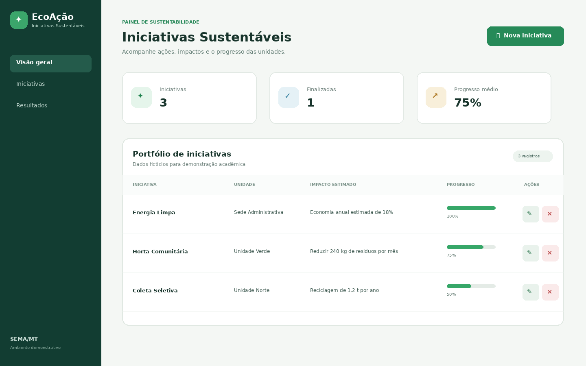

# EcoAção — Iniciativas Sustentáveis

MVP do **Desafio 30** da Formação Claude Code SEMA/MT. Permite cadastrar, consultar, editar e excluir iniciativas, acompanhar progresso e visualizar três indicadores reais calculados no banco.

## Funcionalidades
- CRUD de iniciativas (nome, unidade, impacto estimado e progresso)
- Indicadores: iniciativas, finalizadas e progresso médio
- Persistência SQLite, validação 0–100 e interface responsiva
- Dados exclusivamente fictícios

## Evidência visual


## Executar
### API
```bash
cd backend
python -m venv .venv
# Windows: .venv\Scripts\activate
pip install -r requirements.txt
uvicorn app.main:app --reload
```
API: `http://localhost:8000` · documentação: `http://localhost:8000/docs`

### Interface
```bash
cd frontend
npm install
npm run dev
```
Interface: `http://localhost:5173`

## Testes
```bash
cd backend
pytest -q
```

## Limitações
MVP local sem autenticação, perfis, anexos ou deploy. O SQLite é adequado ao laboratório; PostgreSQL é recomendado para produção.

## Reflexão obrigatória
Escolhi separar frontend, API e persistência para deixar responsabilidades e validações verificáveis. Durante a implementação, a sugestão inicial de considerar toda iniciativa acima de 90% como finalizada foi revisada: pela regra adotada, somente 100% conta como concluída. Também mantive confirmação antes de excluir para reduzir remoções acidentais.
